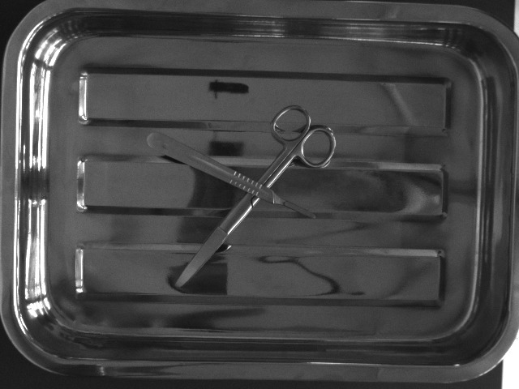
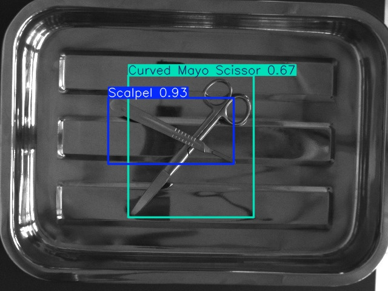
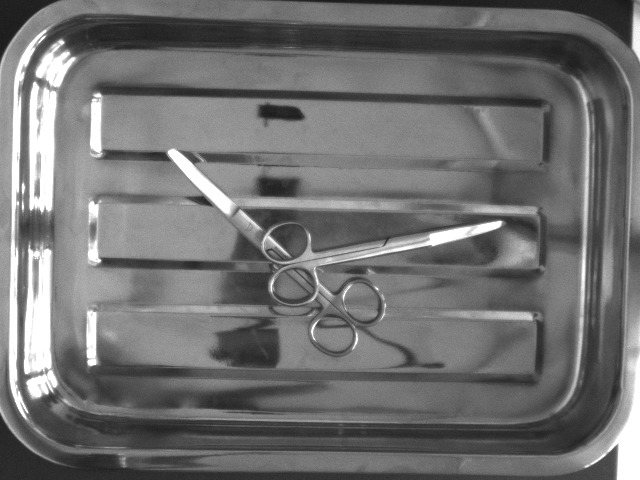
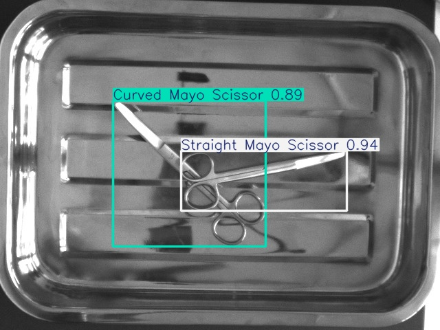
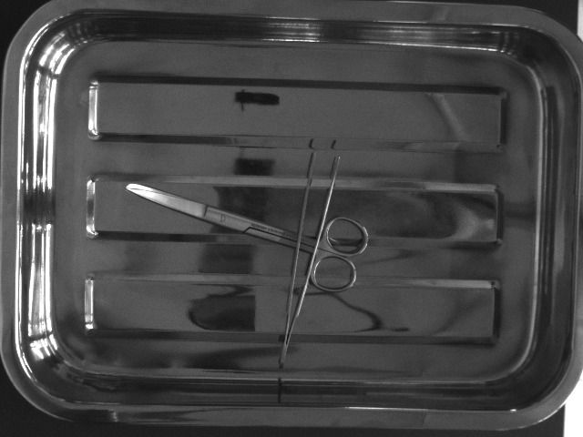
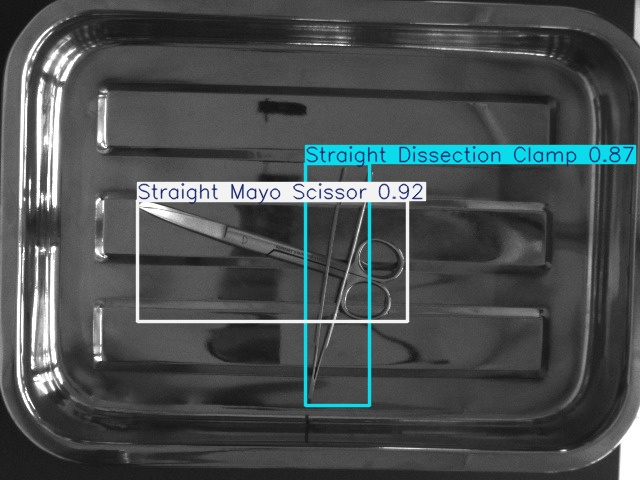

# Surgical Instrument Detector

[](https://opensource.org/licenses/MIT)
[](https://dotnet.microsoft.com/)
[](https://learn.microsoft.com/en-us/dotnet/csharp/)
[](https://onnxruntime.ai/)
[](https://github.com/ultralytics/ultralytics)
[](https://www.kaggle.com/datasets/dilavado/labeled-surgical-tools)
[](https://github.com/amirrezamortazavifard/Surgical-Instrument-Detector/releases/latest)

An open-source computer vision research desktop application for surgical instrument object detection, clinical instrument catalog reference, and AI-assisted consultation. Built with C# and WPF on .NET 8, the system integrates a custom-trained YOLOv11 deep learning model running locally via Microsoft ONNX Runtime alongside a clinical reference database and an optional conversational assistant.

---

## Table of Contents

- [Overview](#overview)
- [Key Features](#key-features)
- [Scientific Documentation](#scientific-documentation)
- [Architecture](#architecture)
- [Inference Visualizations](#inference-visualizations)
- [Application Interface](#application-interface)
- [Technology Stack](#technology-stack)
- [Installation and Setup](#installation-and-setup)
- [Model Training and Export Pipeline](#model-training-and-export-pipeline)
- [Dataset and Attribution](#dataset-and-attribution)
- [Repository Structure](#repository-structure)
- [Author and Contact](#author-and-contact)
- [License](#license)

---

## Overview

Accurate tracking and verification of surgical instruments is critical for surgical education, count verification, and computer-assisted workflow analytics. This repository provides an end-to-end, scientifically reproducible implementation spanning:

1. **AI Model Engineering:** Data audit, deterministic partitioning, training, validation, and ONNX graph export of a YOLOv11 object detector across 4 instrument classes.
2. **Desktop Research Application:** A multi-threaded .NET 8 WPF application built on the MVVM (Model-View-ViewModel) architectural pattern, utilizing DirectShow hardware camera capture, OpenCvSharp4 image processing, bounded latest-frame real-time streaming, and local inference via Microsoft ONNX Runtime.

---

## Key Features

- **Dual Detection Modalities:**
  - **Live Camera Stream:** Bounded latest-frame streaming across connected USB, endoscopic, or built-in camera hardware, maintaining a responsive UI preview without frame queue backlog.
  - **Static Image Analysis:** Single-image analysis with real-time detection confidence scoring, class-aware Non-Maximum Suppression (NMS), and annotated bounding-box rendering.
- **Embedded Inference Runtime:** Leverages Microsoft ONNX Runtime C# API to run model graphs directly within the .NET runtime without external Python runtime dependencies.
- **Dynamic Parameter Tuning:** Real-time sliders in the application Settings view for confidence thresholding, NMS IoU overlap control, and execution provider configuration.
- **Baymax Clinical AI Assistant:** Conversational medical interface utilizing Google Gemini REST API (`gemini-2.5-flash`) with optional image context for protocol lookup and surgical instrument discussions.
- **Interactive Instrument Catalog:** In-memory structured reference database detailing common surgical tools (scalpels, curved and straight Mayo scissors, Metzenbaum scissors, dissection clamps), sterilization parameters, and clinical indications.
- **Operational Telemetry:** Session statistics, detection latency tracking, and instrument frequency metrics.

---

## Scientific Documentation

Comprehensive technical documentation adhering to scientific software publication standards is available in the [`docs/`](docs/) directory:

- [**Software Architecture (`docs/architecture.md`)**](docs/architecture.md): Module decomposition, MVVM design, dependency injection, and Mermaid pipeline flowcharts.
- [**Scientific Reproducibility Guide (`docs/reproducibility.md`)**](docs/reproducibility.md): Deterministic environment prerequisites, dataset splits, training flags, export commands, and test suite execution.
- [**Scientific Limitations & Scope (`docs/limitations.md`)**](docs/limitations.md): Four-class taxonomy boundaries, intraoperative domain gap, CPU throughput constraints, and missing clinical evidence.
- [**Comprehensive Engineering Audit (`docs/engineering-audit.md`)**](docs/engineering-audit.md): Systematic audit of baseline security, vision correctness, and reliability defects with verification evidence.
- [**Research Methods Draft (`docs/research-methods.md`)**](docs/research-methods.md): Manuscript-ready Methods section draft with verified hyperparameters, mathematical letterboxing formulation, and explicit unmeasured placeholders.
- [**Empirical Benchmarking Protocol (`docs/benchmarking.md`)**](docs/benchmarking.md): Monotonic timing protocol, telemetry schemas, and observed execution provider benchmarks.
- [**Security Configuration Guide (`docs/security-configuration.md`)**](docs/security-configuration.md): Multi-tier credential resolution and API key management instructions.

---

## Architecture

The solution separates model development and runtime desktop execution into decoupled sub-systems:

```
Surgical-Instrument-Detector/
├── Python/                        # Offline Training, Validation & Export Subsystem
│   ├── train.py                   # YOLOv11 training script with configurable CLI arguments
│   ├── train_test_val_split.py    # Deterministic dataset partitioner with fixed seed
│   ├── validate_dataset.py        # Automated annotation integrity and leakage auditor
│   ├── run_test_evaluation.py     # Independent test set evaluator exporting JSON/CSV
│   ├── export.py                  # ONNX graph exporter with numerical parity validation
│   ├── benchmark_inference.py     # Standalone empirical latency and FPS benchmark runner
│   ├── data.yaml                  # Class mappings and relative dataset split paths
│   └── tests/                     # 15 automated Python unit tests
│
└── SurgicalDetector/              # Online C# Desktop Application (.NET 8 WPF)
    ├── SurgicalDetector/
    │   ├── Views/                 # WPF XAML views (Live, Image, Chat, Catalog, Settings)
    │   ├── ViewModels/            # MVVM ViewModels with INavigationAware lifecycle
    │   ├── Services/              # ONNX inference, camera capture, telemetry, Gemini REST
    │   ├── Models/                # Detection entities, instrument catalog, inference options
    │   ├── Infrastructure/        # Secure config service, command delegates, converters
    │   └── best.onnx              # Exported YOLOv11 ONNX graph (11.2 MB)
    │
    └── SurgicalDetector.Tests/    # 28 automated C# / xUnit unit tests
```

---

## Inference Visualizations

Trained model inference demonstrated on surgical scene images from the validation set:

| Sample Input | Model Detection Output |
| :---: | :---: |
|  |  |
|  |  |
|  |  |

---

## Application Interface

The desktop application user interface is divided into functional modules:

| View / Module | Primary Functionality | Interface Screenshot |
| :--- | :--- | :---: |
| **Live Camera Detection** | DirectShow camera feed, latest-frame bounding box overlay, FPS & latency telemetry |  |
| **Static Image Detection** | High-resolution image analysis, adjustable confidence & class-aware NMS thresholds |  |
| **Baymax Clinical Assistant** | Conversational interface for surgical guidance, tool discussion, and image analysis |  |
| **Instrument Catalog** | Reference database of surgical instruments, handling specifications, and clinical indications |  |
| **Settings & Providers** | Execution provider status, confidence/IoU sliders, and secure Gemini API configuration |  |

---

## Technology Stack

### Desktop Application (.NET / C#)
- **Framework:** .NET 8.0 (Windows Presentation Foundation)
- **Architecture:** MVVM (Model-View-ViewModel) with Inversion of Control (`Microsoft.Extensions.DependencyInjection`)
- **Inference Runtime:** `Microsoft.ML.OnnxRuntime` 1.22.0 (CPU execution package; CPU provider default)
- **Computer Vision:** `OpenCvSharp4` (4.10.0) with Windows DirectShow capture backend
- **Styling:** Custom high-contrast dark theme optimized for clinical monitor visibility

### Machine Learning & Training (Python)
- **Deep Learning Framework:** PyTorch 2.11 & Ultralytics YOLOv11 (v8.4.33)
- **Model Format:** ONNX (Open Neural Network Exchange, Opset 19)
- **Data Processing:** OpenCV-Python, NumPy, PyYAML

---

## Installation and Setup

### Prerequisites
- Windows 10 (1809+) or Windows 11 (64-bit x64)
- [.NET 8.0 SDK](https://dotnet.microsoft.com/download/dotnet/8.0)
- [Visual Studio 2022](https://visualstudio.microsoft.com/) or .NET CLI

### Build and Run Instructions
1. Clone the repository:
   ```bash
   git clone https://github.com/amirrezamortazavifard/Surgical-Instrument-Detector.git
   cd Surgical-Instrument-Detector
   ```
2. Restore dependencies and compile solution:
   ```powershell
   dotnet restore SurgicalDetector/SurgicalDetector.sln
   dotnet build SurgicalDetector/SurgicalDetector.sln -c Release
   ```
3. Run automated tests (28 unit tests):
   ```powershell
   dotnet test SurgicalDetector/SurgicalDetector.sln
   ```
4. Run the desktop application:
   ```powershell
   dotnet run --project SurgicalDetector/SurgicalDetector/SurgicalDetector.csproj -c Release
   ```

---

## Model Training and Export Pipeline

To retrain or fine-tune the model:

1. Configure Python environment:
   ```bash
   cd Python
   python -m venv venv
   .\venv\Scripts\activate
   pip install torch torchvision ultralytics opencv-python onnx onnxruntime pyyaml numpy pillow
   ```
2. Validate dataset annotations and split integrity:
   ```bash
   python validate_dataset.py --data data.yaml --strict
   ```
3. Execute model training:
   ```bash
   python train.py --model yolo11l.pt --data data.yaml --epochs 100 --batch 16 --imgsz 640
   ```
4. Export the resulting PyTorch weights (`best.pt`) to ONNX:
   ```bash
   python export.py --model YOLO_Result/weights/best.pt --imgsz 640 --opset 19 --simplify --output ../SurgicalDetector/SurgicalDetector/best.onnx
   ```

---

## Dataset and Attribution

The object detection model was trained and evaluated using the **Labeled Surgical Tools and Images** dataset hosted on Kaggle:

[](https://www.kaggle.com/datasets/dilavado/labeled-surgical-tools)

### Dataset Specifications

| Attribute | Specification |
| :--- | :--- |
| **Dataset Title** | [Labeled Surgical Tools and Images](https://www.kaggle.com/datasets/dilavado/labeled-surgical-tools) |
| **Author / Curator** | **Danilo Lavado** ([@dilavado](https://www.kaggle.com/dilavado)) |
| **Platform** | Kaggle |
| **Sample Size** | 2,620 surgical scene images with 3,640 annotated bounding boxes |
| **Annotation Scope** | Planar 2D bounding boxes |
| **Target Classes** | `Scalpel`, `Straight Dissection Clamp`, `Straight Mayo Scissor`, `Curved Mayo Scissor` |

### Scholarly Citation

```bibtex
@misc{dilavado_surgical_tools,
  author       = {Danilo Lavado},
  title        = {Labeled Surgical Tools and Images},
  year         = {2024},
  publisher    = {Kaggle},
  howpublished = {\url{https://www.kaggle.com/datasets/dilavado/labeled-surgical-tools}}
}
```

---

## Repository Structure

| Path | Description |
| :--- | :--- |
| `SurgicalDetector/` | .NET 8 WPF application source code, views, viewmodels, and tests |
| `Python/` | Dataset utilities, training configs, evaluation routines, export script, and benchmarks |
| `Images/Test/` | Test images for evaluation and manual verification |
| `Images/Result/` | Ground-truth and model inference output visualizations |
| `docs/` | Scientific architecture, reproducibility, limitations, methods, and audit documentation |

---

## Author and Contact

**Amirreza Mortazavi Fard**

- **GitHub:** [@amirrezamortazavifard](https://github.com/amirrezamortazavifard)
- **LinkedIn:** [Amirreza Mortazavi Fard](https://www.linkedin.com/in/amir-reza-mortazavi-fard-892874368/)
- **Telegram:** [@ReallyFard](https://t.me/reallyFard)
- **Email:** [mortazavi.a.stu@gmu.ac.ir](mailto:mortazavi.a.stu@gmu.ac.ir)

---

## License

This project is licensed under the **MIT License**. See the [LICENSE](LICENSE) file for complete details.
