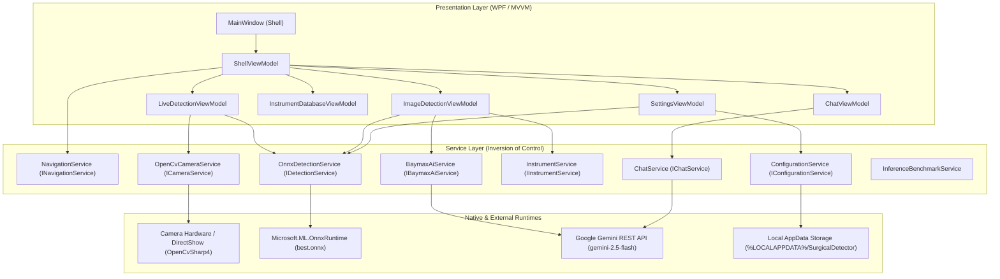
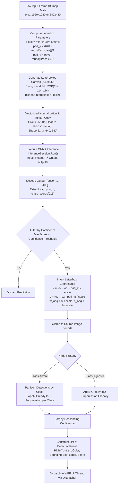
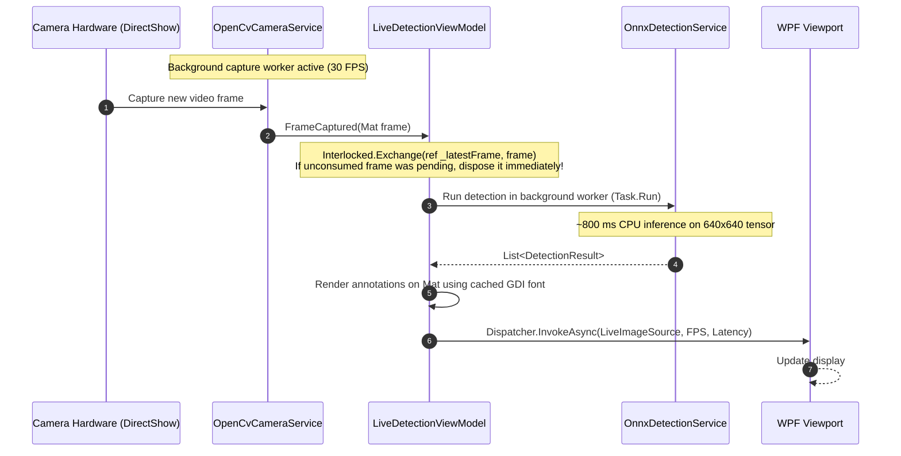

# Software Architecture: Surgical Instrument Detector

## 1. System Overview

The **Surgical Instrument Detector** is an open-source computer vision research desktop application designed for surgical instrument object detection, clinical instrument catalog reference, and optional AI-assisted consultation.

The repository is structured into two decoupled subsystems:
1. **Model Engineering & Validation Subsystem (`Python/`):** Dataset validation, train/val/test splitting, deep learning training with Ultralytics YOLOv11, test set evaluation, and ONNX graph export.
2. **Desktop Runtime Application (`SurgicalDetector/`):** A native Windows Presentation Foundation (WPF) client running on .NET 8, implementing the Model-View-ViewModel (MVVM) design pattern with dependency injection, local ONNX Runtime model inference, and DirectShow camera capture.

---

## 2. Component & Module Architecture



### Module Responsibilities

| Module / Component | Implementation Location | Responsibility |
| :--- | :--- | :--- |
| **`MainWindow` & `ShellViewModel`** | `SurgicalDetector/MainWindow.xaml`, `ViewModels/ShellViewModel.cs` | Hosts navigation chrome, application window lifecycle, and view switching. |
| **`NavigationService`** | `Services/NavigationService.cs`, `Services/INavigationAware.cs` | Manages view activation and teardown via `INavigationAware` (`OnNavigatedTo`, `OnNavigatedFrom`). |
| **`OnnxDetectionService`** | `Services/OnnxDetectionService.cs`, `Services/IDetectionService.cs` | Manages ONNX session initialization, input letterbox preprocessing, inference execution, coordinate transformation, and class-aware/class-agnostic NMS. |
| **`OpenCvCameraService`** | `Services/OpenCvCameraService.cs`, `Services/ICameraService.cs` | Encapsulates camera enumeration and asynchronous capture using OpenCvSharp DirectShow backend. |
| **`LiveDetectionViewModel`** | `ViewModels/LiveDetectionViewModel.cs` | Manages camera lifecycle, latest-frame non-blocking queue (`Interlocked.Exchange`), background inference dispatch, and UI telemetry updates. |
| **`ImageDetectionViewModel`** | `ViewModels/ImageDetectionViewModel.cs` | Handles static image loading, parameter-driven object detection, bounding-box rendering, and export. |
| **`InstrumentDatabaseViewModel` & `InstrumentService`** | `ViewModels/InstrumentDatabaseViewModel.cs`, `Services/InstrumentService.cs` | Provides local catalog of surgical instruments, handling specifications, sterilization parameters, and clinical indications. |
| **`ConfigurationService`** | `Infrastructure/ConfigurationService.cs` | Multi-tier credential and settings resolution (`GEMINI_API_KEY` env var -> `%LOCALAPPDATA%\SurgicalDetector\config.json`). |
| **`BaymaxAiService` & `ChatService`** | `Services/BaymaxAiService.cs`, `Services/ChatService.cs` | HTTP client wrapper for Google Gemini REST API (`gemini-2.5-flash`) for clinical question-answering with optional image context. |

---

## 3. Dependency Injection & MVVM Design

The application configures its dependency injection container during startup in [`App.xaml.cs`](../SurgicalDetector/SurgicalDetector/App.xaml.cs) using `Microsoft.Extensions.DependencyInjection`:

- **Singleton Services:**
  - `IConfigurationService` (`ConfigurationService`): Thread-safe settings management.
  - `INavigationService` (`NavigationService`): View navigation state.
  - `IDetectionService` (`OnnxDetectionService`): Heavyweight ONNX inference session (`InferenceSession`) initialized once and reused across detection requests.
  - `ICameraService` (`OpenCvCameraService`): Hardware camera resource manager.
  - `IInstrumentService` (`InstrumentService`): In-memory instrument reference database.
  - `IChatService` (`ChatService`) & `IBaymaxAiService` (`BaymaxAiService`): Asynchronous HTTP clients.
- **Singleton ViewModels:**
  - `ShellViewModel`, `LiveDetectionViewModel`, `ImageDetectionViewModel`, `InstrumentDatabaseViewModel`, `ChatViewModel`, `SettingsViewModel`.
  - Registered as singletons to preserve user input and navigation state while using `INavigationAware` to halt hardware-intensive background workers on tab departure.

---

## 4. Separation of Concerns: Training vs. Export vs. Runtime

```
+-----------------------------------------------------------------------------------+
|                        OFFLINE TRAINING & EXPORT (Python)                         |
|                                                                                   |
|  [Raw Dataset] -> train_test_val_split.py -> validate_dataset.py -> train.py     |
|                                                                          |        |
|                                                                     (PyTorch .pt) |
|                                                                          v        |
|  [Independent Test Set] <- run_test_evaluation.py <------------------ export.py   |
|                                                                          |        |
|                                                                    (best.onnx)    |
+--------------------------------------------------------------------------|--------+
                                                                           |
                                                                           v
+-----------------------------------------------------------------------------------+
|                          ONLINE RUNTIME DESKTOP (.NET 8)                          |
|                                                                                   |
|  [Camera / Image File]                                                            |
|          |                                                                        |
|          v                                                                        |
|  [OpenCvSharp4 / DirectShow] -> [Letterbox 640x640]                               |
|                                         |                                         |
|                                         v                                         |
|                              [Microsoft.ML.OnnxRuntime]                           |
|                               (CPUExecutionProvider)                              |
|                                         |                                         |
|                                         v                                         |
|                         [Inverse Transform & Decoded NMS]                         |
|                                         |                                         |
|                                         v                                         |
|                             [WPF UI Viewport Display]                             |
+-----------------------------------------------------------------------------------+
```

1. **Training Subsystem (`Python/`):**
   - Implemented with PyTorch and Ultralytics YOLOv11.
   - Outputs PyTorch checkpoint `Python/YOLO_Result/weights/best.pt`.
   - Validates on independent test partition (`Python/run_test_evaluation.py`).
2. **Export Bridge (`Python/export.py`):**
   - Converts PyTorch checkpoint to ONNX format with static shape `[1, 3, 640, 640]` and Opset 19.
   - Verifies numerical parity between PyTorch outputs and ONNX Runtime outputs.
   - Deploys exported graph to `SurgicalDetector/SurgicalDetector/best.onnx`.
3. **Runtime Subsystem (`SurgicalDetector/`):**
   - Independent of Python; relies entirely on native C# and `Microsoft.ML.OnnxRuntime`.
   - Directly parses raw model output tensor `[1, 8, 8400]`.

---

## 5. Vision Inference Pipeline & Flowchart



---

## 6. Camera Capture & Frame Management Workflows



---

## 7. Actual Dependencies and Model Artifacts

### Runtime Package Manifest (`SurgicalDetector.csproj`)
- **Target Framework:** `net8.0-windows`
- **`Microsoft.ML.OnnxRuntime`:** Version `1.22.0` (CPU execution package; `CPUExecutionProvider` active).
- **`OpenCvSharp4`:** Version `4.10.0.20241108` (native video capture and matrix structures).
- **`OpenCvSharp4.WpfExtensions`:** Version `4.10.0.20241108` (fast `WriteableBitmap` conversion).
- **`OpenCvSharp4.runtime.win`:** Version `4.10.0.20241108` (packaged Windows native binaries).
- **`Microsoft.Extensions.DependencyInjection`:** Version `9.0.10` (IoC container).
- **`System.Drawing.Common`:** Version `9.0.6` (GDI+ bitmap rendering and coordinate geometry).

### Deployed Model Artifact
- **Path:** [`SurgicalDetector/SurgicalDetector/best.onnx`](../SurgicalDetector/SurgicalDetector/best.onnx)
- **Filesize:** 11,208,495 bytes (~11.2 MB)
- **Model Topology:** Ultralytics YOLOv11 large architecture (`yolov11l`)
- **Input Node:** Name: `images`, Shape: `[1, 3, 640, 640]`, Type: `float32`
- **Output Node:** Name: `output0`, Shape: `[1, 8, 8400]`, Type: `float32`
- **Trained Target Classes (4):**
  - Index `0`: `Scalpel`
  - Index `1`: `Straight Dissection Clamp`
  - Index `2`: `Straight Mayo Scissor`
  - Index `3`: `Curved Mayo Scissor`
