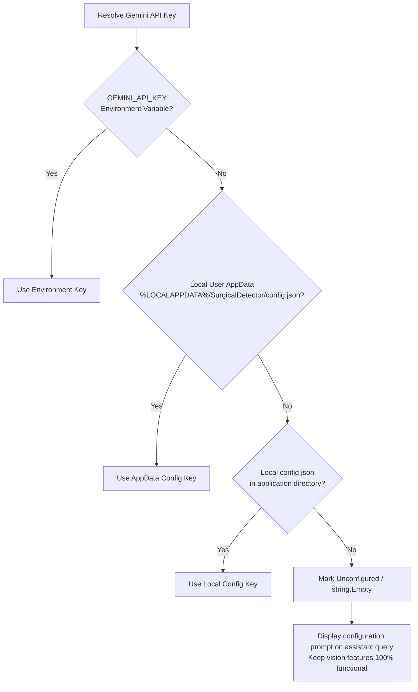

# Security & Configuration Guide: Gemini API Integration

## 1. Security Overview & Credential Policy

The **Surgical Instrument Detector** application strictly enforces a zero-hardcoded-credentials policy across all source code, unit tests, scripts, and documentation.

### Core Principles
- **No Embedded Credentials:** No API keys, tokens, passwords, or connection strings may be placed in tracked files.
- **No Fallback Credentials:** When no credential is provided, the application defaults to an empty state rather than falling back to any bundled key.
- **Graceful Offline Degradation:** If the Gemini API key is not configured, all computer-vision object detection features (image analysis, live stream camera detection, database catalog) remain 100% functional. Only the conversational Generative AI assistant ("Baymax") informs the user that configuration is required.
- **Zero Secret Exposure:** API keys are never printed in console logs, error messages, test outputs, or user notifications.

---

## 2. Configuration Mechanisms

The application resolves the Google Gemini API key using a multi-tiered hierarchy:



### Method 1: Environment Variable (`GEMINI_API_KEY`) [Recommended for Developers & Researchers]
Set the environment variable `GEMINI_API_KEY` on your machine.

**Windows PowerShell (Current Session):**
```powershell
$env:GEMINI_API_KEY = "your_actual_gemini_key_here"
```

**Windows PowerShell (Persistent User Environment):**
```powershell
[System.Environment]::SetEnvironmentVariable('GEMINI_API_KEY', 'your_actual_gemini_key_here', 'User')
```

**Linux / macOS:**
```bash
export GEMINI_API_KEY="your_actual_gemini_key_here"
```

### Method 2: In-App User Settings [Recommended for Clinicians & End Users]
1. Launch the Desktop Application:
   ```powershell
   dotnet run --project SurgicalDetector/SurgicalDetector/SurgicalDetector.csproj
   ```
2. Navigate to **Settings** from the left navigation bar.
3. Locate the **Generative AI & Baymax Assistant** section.
4. Enter your Gemini API key in the API Key input field.
5. Click **Save Configuration**.
6. The key is securely saved to your local user profile at:
   `%LOCALAPPDATA%\SurgicalDetector\config.json`
   This file is outside the Git working tree and is never committed to version control.

### Method 3: Local Configuration File
Copy the provided template to your local user directory:
```powershell
# Copy template to user AppData
New-Item -ItemType Directory -Force -Path "$env:LOCALAPPDATA\SurgicalDetector"
Copy-Item "config.example.json" -Destination "$env:LOCALAPPDATA\SurgicalDetector\config.json"
```
Edit `%LOCALAPPDATA%\SurgicalDetector\config.json` to insert your key:
```json
{
  "GeminiApiKey": "your_actual_gemini_key_here",
  "ConfidenceThreshold": 0.5,
  "NmsThreshold": 0.45,
  "UseLetterbox": true,
  "ExecutionProvider": "CPU"
}
```

---

## 3. Graceful Handling of Missing Credentials

When no key is configured:
1. The desktop application starts and functions normally.
2. Clicking **Image Detection** or **Live Detection** detects surgical instruments using the local ONNX model without needing internet or cloud credentials.
3. Clicking **Ask Baymax** or sending a message returns a polite notification:
   > *"Baymax Alert: Gemini API key is not configured. Please configure your API key in Settings or set the GEMINI_API_KEY environment variable."*
4. Zero unhandled exceptions or network timeouts occur.

---

## 4. Threat Model & Distributed Desktop Considerations

> [!WARNING]
> **Environment Variables vs. Binary Distribution:**
> Storing keys in environment variables or local JSON files prevents *accidental source code disclosure* to public Git repositories during development.
> 
> However, for public distribution of client-side desktop software, shipping any global application credential inside binaries or configuration files exposes that credential to reverse engineering and extraction.
> 
> For public deployment, two secure architectures are recommended:
> 1. **Bring Your Own Key (BYOK):** End users or clinical institutions supply their own API key (implemented via the Settings page in this release).
> 2. **Backend Gateway:** Route AI requests through a dedicated backend API service that handles authentication, rate limiting, and credential storage on a secure server.

---

## 5. Compromised Key Revocation Protocol

> [!CAUTION]
> **Committed Credentials Must Be Considered Compromised:**
> Simply deleting a credential from the latest commit or modifying source code does **NOT** revoke the key if it was committed in Git history. Anyone with access to repository history can retrieve historical values.

### Step-by-Step Revocation Procedure
1. **Access Google AI Studio / GCP Console:**
   - Google AI Studio: [https://aistudio.google.com/app/apikey](https://aistudio.google.com/app/apikey)
   - Google Cloud Console: [https://console.cloud.google.com/apis/credentials](https://console.cloud.google.com/apis/credentials)
2. **Locate the Exposed Key:**
   - Search for the key matching the previously exposed prefix.
3. **Delete / Revoke the Key Immediately:**
   - Click the trash/delete icon to permanently invalidate the compromised credential. All requests using the compromised key will immediately fail with HTTP 403/400.
4. **Generate a New API Key:**
   - Click **Create API Key**.
5. **Apply API Restrictions:**
   - Under **API restrictions**, restrict key usage strictly to the **Generative Language API**.
6. **Deploy the New Key Locally:**
   - Configure the new key using `GEMINI_API_KEY` or through the desktop application's Settings view.
